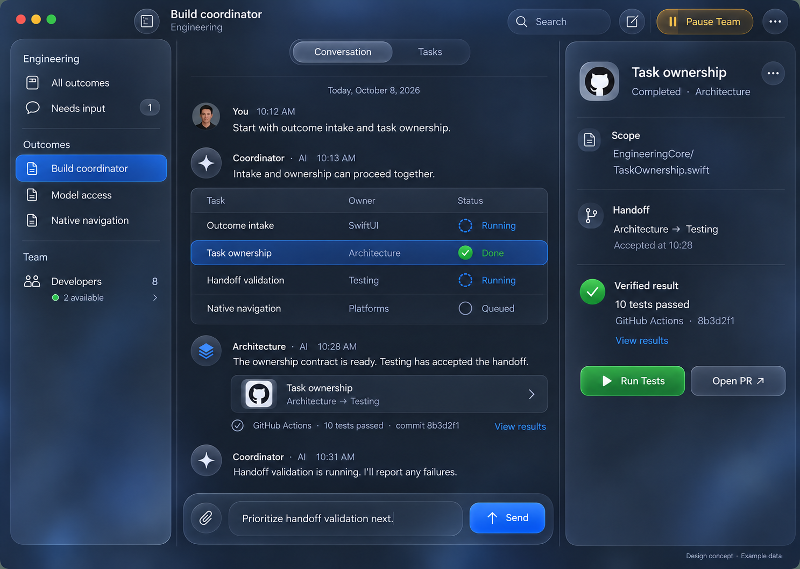

# Engineering Studio design direction

The approved workspace concept sets the native app’s composition. The [current SwiftUI review](SwiftUI-review.md) refines its surfaces using neutral-first design principles:

This image is a design concept with example data, not a running application.

## Structure

- Use three native resizable panes on Mac (`HSplitView`): outcomes, conversation/tasks, selected task details. This allows the sidebar and detail panel to be inset beneath the unified toolbar as in the reference. Use `NavigationSplitView` on iOS to adapt the same selections to compact navigation.
- Let the content background continue beneath the native unified toolbar. Place controls in the system's rounded toolbar groups; avoid a separate, contrasting header panel.
- Keep task inspection in the third column. Use native sheets for bounded flows such as creating an outcome. Mac preferences use a native Settings scene; iOS settings use a sheet.
- Preserve a persistent composer for the selected outcome. Follow-up messages belong to that outcome and inform its next plan.

## Materials and actions

- Use standard materials for content structure and Liquid Glass for interactive surfaces such as primary actions. The composer uses regular standard material so its glass Send button is not nested inside glass.
- Choose materials for their semantic role. Let the system respond to window activity, wallpaper, Increase Contrast and Reduce Transparency; do not bake the concept's apparent glass color into images.
- Use blue for Send, green for Run/Prepare, and amber for Pause/Cancel. Keep labels and SF Symbols so color is supplementary.
- Keep typography native, content selectable, column sizes flexible and secondary text legible. Use system controls and keyboard commands.
- Use only SF Symbols for workspace icons (`Image(systemName:)` and `Label(systemImage:)`), including task and coordinator badges. Do not copy the concept's GitHub logo or fictitious portrait.
- Preserve the reference's hierarchy with shared system typography roles, 48-point conversation badges, a 62-point task badge, and approximately 44–50-point primary content controls. Task, Owner and Status use separate columns when space permits and stacked metadata in compact/accessibility layouts.

## Apple implementation references

Reviewed through Firecrawl on 2026-10-10 alongside the SwiftUI Expert, Liquid Glass and UI Patterns skills:

- [Applying Liquid Glass to custom views](https://developer.apple.com/documentation/swiftui/applying-liquid-glass-to-custom-views): apply the glass effect after layout and use native glass button styles for interactive controls.
- [Materials](https://developer.apple.com/design/human-interface-guidelines/materials): standard materials establish content structure beneath glass. Material role and accessibility behavior guide the system appearance; no decorative blue backdrop is required.
- [HSplitView](https://developer.apple.com/documentation/swiftui/hsplitview): native Mac panes with draggable dividers.
- [NavigationSplitView](https://developer.apple.com/documentation/swiftui/navigationsplitview): selection-driven columns and compact navigation.
- [Image(systemName:)](https://developer.apple.com/documentation/swiftui/image/init(systemname:)): system-provided SF Symbol images.

## Truthful states

The reference depicts running developers, successful tests and an existing pull request. Those states require real evidence. Until connected execution exists, show planned tasks, zero connected developers, and unavailable test/PR controls with explanations. Never populate the production workspace with the concept's example activity.

## Implementation and evidence

The app implementation lives in `Apps/EngineeringStudio`, coordination logic in `Packages/EngineeringCore`, and disposable native capture infrastructure in `Tools/SwiftUIPreview`. All implementation code is Swift.

[Native screenshots](../Previews/README.md) show the actual views with isolated preview data. [Design QA](../../design-qa.md) records the comparison and outstanding validation. A preview build does not establish that the complete SDK 27 application or external services are ready.
