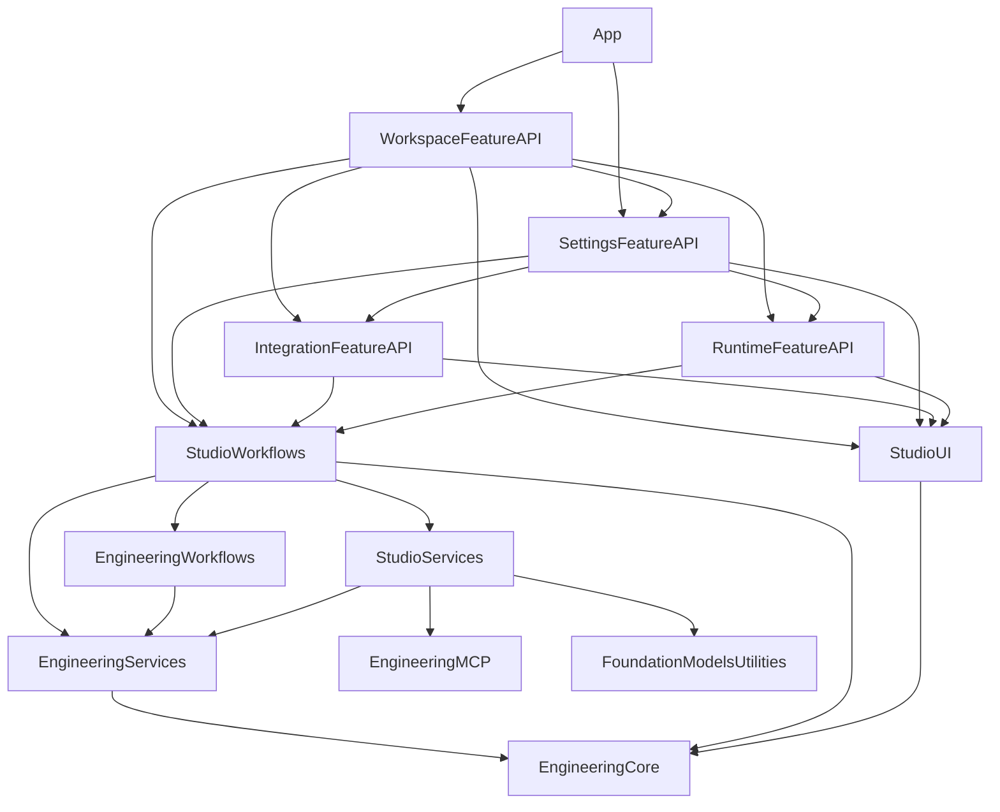

# Engineering Studio module map

The app follows App → Features → Workflows → Services → Core. The SwiftPM target graph under `Apps/EngineeringStudio/Package.swift` enforces these boundaries; folders alone do not establish them. The Xcode application targets compile only the scene and application delegate, then link the feature/workflow products they use.

## Ownership

| Layer | Modules and responsibilities |
| --- | --- |
| App | `App/EngineeringStudioApp.swift` creates shared dependencies, defines scenes and forwards lifecycle events. Each `StudioWindow` owns its feature navigation and delivers parsed deep-links. `StudioAppDelegate` coordinates normal Mac termination. Assets, entitlements and URL-scheme registration live here. |
| Features | `WorkspaceFeature`, `IntegrationFeature`, `RuntimeFeature` and `SettingsFeature` implement native screens and expose named public `*FeatureAPI` entry points. `WorkspaceNavigation` exposes routing without exporting view implementation. Peer features call the exposed API. |
| Workflows | `StudioWorkflows` owns workspace/draft state, planning orchestration, account-bound runtime coordination, Linear publication/reconciliation and composed startup/shutdown. `EngineeringWorkflows` schedules developers and dependency handoffs over lower-level execution services. |
| Services | `EngineeringServices` implements typed GitHub/Linear APIs, subscription authentication/transport and developer execution infrastructure. `StudioServices` implements Apple authentication, Keychain, Foundation Models integration and native loopback infrastructure. `EngineeringMCP` wraps the official Swift MCP client with reviewed read-only operations. |
| Core | `EngineeringCore` owns value models, scope, persistence and networking contracts/primitives. `StudioUI` contains semantic materials, reusable symbols, spacing and typography. `FoundationModelsUtilities` retains Apple's library and its existing public product. |

The diagram summarizes module direction; direct Core imports are allowed from higher layers. Core modules never import Services, Workflows or Features. Services never import Workflows or Features. Feature implementation types remain internal. Public entry points accept the composition facade; package access lets app-owned modules share state without making those implementation types public to other packages. FoundationModelsUtilities retains its established public API.

## Migration order

1. **Core:** relocate the unchanged utilities source into `Apps/EngineeringStudio/Core/FoundationModelsUtilities` and set the root target's explicit path. Extract models, scope, persistence and transport contracts from the former EngineeringCore package. Preserve public product names and existing fixtures.
2. **Services:** move provider, authentication, model and execution implementations out of Core; split combined provider declarations into individual files. Introduce `EngineeringMCP` as an independent transport boundary pinned to SDK 0.12.1.
3. **Workflows:** move developer orchestration and app state/publication orchestration above services. Use a composition facade for one startup sequence and durable shutdown.
4. **Features:** group screens by capability, publish feature APIs and replace peer view construction with API calls. Place reusable presentation primitives in StudioUI.
5. **App:** leave scenes, deep-link delivery and dependency wiring in the Xcode source phase. The existing `engineeringstudio` registration supports outcome routes and the fixed GitHub OAuth route; the active authentication session validates its own complete callback before exchanging a code.

No duplicate compatibility source tree is kept. The root FoundationModelsUtilities package remains usable; the former `Packages/EngineeringCore` package is replaced by app-owned portable products. Tests now live under `Apps/EngineeringStudio/Tests`: system contracts, MCP contracts and the native regression/capture executable.

## Validation and next integration pass

Run `swift test --package-path Apps/EngineeringStudio --jobs 2` with Swift 6.4 for portable tests. On an Apple host with Xcode 27, build both shared Xcode schemes and run the native MCP fixtures. `swift Tools/SwiftUIPreview/BuildPreview.swift` builds the regression/capture host through the same SwiftPM graph and exercises the actual Apple framework with deterministic fixtures.

The existing REST/GraphQL connections and deterministic write workflows remain operational code. The Connections UI now composes separate native OAuth/MCP services through `ServiceConnections`: protected metadata restoration, explicit browser sign-in, silent refresh and protocol/catalog checks. See [Provider authorization](Provider-authorization.md) for registration, callback, cancellation and validation boundaries. Bounded MCP planner-context collection remains a further integration: a catalog is not a business API. Add reviewed, typed operations in Services, compose them in Workflows and expose their status through Features.

For a new module, identify its responsibility first: a user capability belongs in Features; a generic primitive belongs in Core; domain logic belongs in Services; coordination across services belongs in Workflows. Declare only the lower-layer products it actually needs, then verify the target before migrating its callers.
