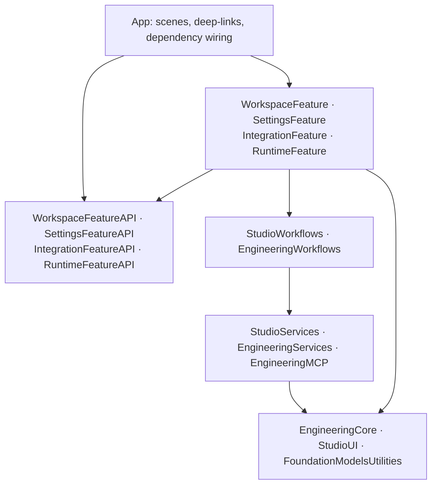

# Native provider adapters and MCP

Architecture proposal and research checkpoint, 2026-10-12. This document separates the app's existing connections, the shared MCP client introduced in this draft, and proposed account-login and model-tool flows. Provider registrations, browser consent, live MCP authorization and model-driven MCP calls have not been activated.

## Decision

Keep GitHub and Linear behind domain adapters in the Services layer. Use native system-browser authorization so each platform can offer its own passkey, SSO or other account login. Provide typed REST/GraphQL and official remote MCP implementations behind those boundaries. Preserve the existing deterministic publication workflow and receipt validation rather than replacing writes with unrestricted model-selected tools.

Start with workflow-controlled, scoped MCP reads. A workflow obtains bounded repository or ticket context, validates its provenance and scope, then supplies it to the planner. The current ChatGPT adapter supports guided generation, not tool execution; the planner continues to use `.toolCallingMode(.disallowed)`. A future tool-capable model can receive curated Foundation Models tools after its executor and failure behavior are implemented and tested.

No extra GitHub token or Linear API key is needed for repository development or this draft PR. Live account login needs provider registration and consent as described below. A Swift confidential token broker is an optional deployment choice; authentication is not intrinsically tied to a Mac, Cloudflare Worker, Node runtime or developer execution host.

## Current implementation and proposed connection flows

The app already uses Swift URLSession/Codable clients, Keychain storage and explicit repository/project validation. Public GitHub reads work without credentials. The existing Connections UI accepts a GitHub token and Linear API key; it verifies the resource before replacing a saved credential. Linear publication persists caller-generated issue UUIDs and reconciles ambiguous responses. GitHub test evidence is tied to commits and actual service responses. See [Service integrations](Service-integrations.md).

This draft adds a shared read-only MCP transport under `EngineeringMCP`; SDK initialization and tool requests are distinct from account authorization and app feature activation. The browser-login controls, provider-specific OAuth adapters and planner-context orchestration described here are proposed next steps. A client implementation or successful build does not prove that a user's account authorized either remote server.

| Adapter | Proposed login and registration | Credentials and boundaries |
| --- | --- | --- |
| GitHub REST | Register a GitHub App; configure the app callback; authorize through the system browser with state and S256 PKCE; install the app on the selected repository. | GitHub's code exchange requires client ID and client secret, even with PKCE. Use a user access token. Public native clients cannot keep the app secret confidential; see the caveat below. No app private key is required for this flow. |
| GitHub remote MCP | Connect to `https://api.githubcopilot.com/mcp/` using the host's registered GitHub App or OAuth App authorization. | GitHub documents host-owned registration. Its live metadata advertises no dynamic registration endpoint. The read client also sends `X-MCP-Readonly: true`; that catalog mode does not establish a repository boundary. PAT authentication remains a fallback. |
| Linear GraphQL | Register a Linear OAuth application and exact callback; use system-browser authorization code with state and S256 PKCE, initially as the user. | Client ID is required. Client secret is optional for PKCE code exchange and refresh. Read/update scopes apply to accessible account data; enforce the project's UUID in the adapter. |
| Linear remote MCP | Use the documented read-only endpoint `https://mcp.linear.app/mcp/readonly`; discover authorization metadata and register a public client through the documented OAuth 2.1/DCR flow. | A manually created Linear OAuth application is not required for this DCR path. The SDK accepts matching parent `/mcp` protected-resource metadata for this endpoint. Existing Linear OAuth tokens or API keys are also accepted as Bearer credentials. Keep authentication separate per workspace. |

Passkey login and OAuth consent are complementary: the passkey proves the person's identity to the provider, and the resulting grant authorizes Engineering Studio. Both [GitHub](https://docs.github.com/en/authentication/authenticating-with-a-passkey/signing-in-with-a-passkey) and [Linear](https://linear.app/docs/login-methods#passkey) document passkeys. Offer “Connect GitHub” and “Connect Linear”; let the provider choose its login method instead of promising a passkey-only flow.

Apple's [ASWebAuthenticationSession](https://developer.apple.com/documentation/authenticationservices/aswebauthenticationsession) authenticates through third-party web services and delivers the callback to the requesting session. Use the current `URL + Callback` API with the exact registered custom-scheme or associated HTTPS callback that the provider accepts. SDK callback configuration does not create a loopback listener or register a URL scheme automatically.

Do not request GitHub or Linear passkey assertions directly with `ASAuthorizationPlatformPublicKeyCredentialProvider`. Apple's [passkey flow](https://developer.apple.com/documentation/authenticationservices/supporting-passkeys) requires the relying party's challenge and server-side verification; [associated domains](https://developer.apple.com/documentation/xcode/supporting-associated-domains) require an association file on the corresponding website. Engineering Studio does not control either provider's relying party.

## GitHub's public-client caveat

GitHub's current [GitHub App best practices](https://docs.github.com/en/apps/creating-github-apps/about-creating-github-apps/best-practices-for-creating-a-github-app) explicitly acknowledge that native public clients cannot secure their client secret, yet require it for browser code exchange and recommend PKCE. Native clients should generate user access tokens; they must never ship an app private key or generate installation tokens on-device.

The native-only option therefore uses GitHub's documented public-client model. Registration credentials must be provisioned outside this repository. Keychain protects local storage but does not make a distributed client secret confidential, and that secret must not be treated as proof that a request came from the genuine app.

If confidential handling is chosen, move code exchange, refresh and revocation to a Swift broker with a securely bound app return flow. Cloudflare Tunnel/Access can protect that Swift service where the chosen deployment supports them. This is optional infrastructure, not a mandatory Mac authentication runner or a reason to add JavaScript.

GitHub supports a client-ID-only device flow, but its [best practices](https://docs.github.com/en/apps/oauth-apps/building-oauth-apps/best-practices-for-creating-an-oauth-app) prefer browser authorization code + PKCE and advise against enabling device flow outside constrained CLI, IoT or headless systems. Reserve it for an explicitly chosen execution-host connection. Honor the returned polling interval, `slow_down`, cancellation and expiry; do not present it as the default native app sign-in.

## Authorization, identity and receipts

The configured resources are `kmshdev/foundation-models-utilities` and Linear project `c655b4e0-e003-424a-a29a-3674e9a3983b` (Engineering Workflow Automation). Keep those identifiers in Core policy values and revalidate them before each operation, after awaited work and in returned mutation receipts.

- Install the GitHub App on the selected repository. User-token access is the intersection of the app's installation/permissions and the person's access. Start with Contents read, Pull requests write and Actions/Checks read; grant Contents write only to an execution path that needs to push branches. Request no repository administration permission.
- Linear's documented OAuth scopes do not provide a project-only grant. Validate workspace, team and project IDs in the adapter; resolve an existing issue's project before changing it. `read,write` enables ticket updates; `issues:create` and `comments:create` are narrower alternatives when those are the only required writes. Do not request `admin` for ordinary coordination.
- Share one authorized service connection across the eight runtime specialists; do not require eight provider logins. Keep their task ownership and handoff identities in the app.
- Treat tool descriptions, annotations and returned text as untrusted context. Toolset selection and read-only endpoints reduce exposure; they do not authorize arbitrary repositories, projects or actions.
- Preserve stable issue UUIDs, partial-publication recovery, commit-bound GitHub evidence and confirmed PR receipts. A timeout or cancellation can occur after a mutation committed, so reconcile before retrying.

Linear `actor=app` is a separate optional agent installation. It requires workspace-admin installation, can request `app:assignable`/`app:mentionable`, and sets the app as an issue delegate while the human remains the assignee. Agent-session events require a real webhook receiver. This is not necessary for the personal user's first connection. Client-credentials grants require a confidential app secret and must not replace mobile browser login.

Store credential records separately by provider, issuer, client ID and account/workspace. Serialize refresh and atomically replace rotating token pairs. Cancel account-bound work on identity changes and prevent late responses from restoring a disconnected account.

| Provider token | Lifetime and refresh | Disconnect/revoke |
| --- | --- | --- |
| GitHub App user token | Expiring tokens last eight hours; refresh tokens six months. Refresh rotates both tokens. Client secret is required except for tokens originally generated by device flow. | `DELETE /applications/{client_id}/token` requires client-ID/client-secret Basic authentication. Provider settings can revoke the app authorization. Keychain deletion alone only disconnects locally. |
| Linear OAuth token | Access tokens last 24 hours. Refresh rotates the pair; PKCE refresh needs client ID, without a client secret. Linear documents a 30-minute recovery/replay grace period for an interrupted refresh response. | `POST https://api.linear.app/oauth/revoke` with form field `token` and optional `token_type_hint`. MCP's discovered revocation endpoint is provider-specific; use that metadata for MCP-issued credentials. |

## Swift MCP and Foundation Models boundaries

Pin [modelcontextprotocol/swift-sdk](https://github.com/modelcontextprotocol/swift-sdk/tree/0.12.1) exactly to **0.12.1**, released 2026-05-07, commit `a0ae212ebf6eab5f754c3129608bc5557637e605`. Its actual manifest requires Swift 6.1 and supports iOS 16/macOS 13; the app's Swift 6.4 and SDK 27 targets satisfy that baseline. The package product is `MCP`.

The SDK's latest supported protocol is **2025-11-25**, with earlier supported versions. The current MCP specification is **2026-07-28**. Negotiate a provider-supported version during initialization; neither using a current server nor pinning SDK 0.12.1 means the client implements the newest specification. Reject an unsupported negotiated version rather than pretending newer protocol features are available.

`Client` and `HTTPClientTransport` are actors. The SDK includes OAuth discovery, DCR/client-metadata recognition, PKCE, state/redirect checks, resource indicators, refresh and bounded authentication retries. It still needs an app-owned browser authorization delegate, real callback handling and persistent token storage. Do not share an `OAuthAuthorizer` instance across transports; it is unchecked Sendable and mutable.

Use the typed `CallTool` request when structured results matter: the SDK's convenience `callTool` return omits `structuredContent`. Enforce adapter deadlines and issue protocol cancellation on timeout or task cancellation. Cancellation is advisory and does not roll back server work. The package's SSE path is unavailable on Linux, and PKCE uses CryptoKit; portable Core tests alone do not verify native MCP authorization or streaming.

Apple's [Tool protocol](https://developer.apple.com/documentation/foundationmodels/tool) uses typed generated arguments and prompt-representable output. Tools are Sendable and can be called concurrently, so implementations need safe service isolation. Begin with a small curated set of domain operations rather than automatically exposing every discovered MCP tool.

[Dynamic profiles and instructions](https://developer.apple.com/documentation/foundationmodels/composing-dynamic-sessions-with-instructions-and-profiles) can reevaluate request-time state, adjust available tools, check calls before execution and record outputs. `GenerationOptions.ToolCallingMode` expresses allowed/required/disallowed generation behavior; it is not the application's authorization system. Preserve distinctions between `LanguageModelError`, `SystemLanguageModel.Error`, session errors and provider/tool failures.

[DynamicGenerationSchema](https://developer.apple.com/documentation/foundationmodels/dynamicgenerationschema) supports runtime schema construction, but neither Apple documentation nor FoundationModelsUtilities establishes a lossless mapper for arbitrary MCP JSON Schema. The utilities' skill wrappers are useful examples, not a general MCP schema validator.

FoundationModelsUtilities remains a Core leaf dependency at `Core/FoundationModelsUtilities`, with its root Swift package product retained. Its `rollingWindow`, `droppingCompletedToolCalls` and `summarizeHistory` helpers can manage model context. Execution and publication receipts remain durable outside any prunable transcript.

## Layer ownership and migration order

The module direction follows App → Features → Workflows → Services → Core. Features expose public APIs that other features can consume; lower layers never depend on feature implementations. Core has no dependencies on app layers, although it can import system frameworks.

- **Core:** value models, service scope, persistence primitives, networking contracts, reusable native UI and Foundation Models utilities.
- **Services:** provider authentication/token storage, typed GitHub/Linear adapters, model transport, runtime transport infrastructure and the shared MCP transport. `EngineeringMCP` does not own UI or cross-service workflow policy.
- **Workflows:** plan-context collection, ticket publication/reconciliation, developer dispatch, handoffs and test/PR evidence orchestration. They combine services and return domain results.
- **Features:** workspace, settings, integrations and runtime experiences with public entry points. Feature-to-feature use goes through the exposed API rather than another feature's implementation internals.
- **App:** scenes, deep-links and dependency composition; it does not implement provider business rules.

Migrate leaf modules first, preserve their tests and public product boundaries, then move services, workflows, feature APIs/implementations and finally app composition. Portable checks now use the app-owned package; the root FoundationModelsUtilities package retains its public product with an explicit source path. See the [module map](Module-architecture.md) for the implemented graph.

## Evidence and remaining validation

Official pages were retrieved with Firecrawl on 2026-10-12; live unauthenticated discovery was independently checked with HTTP GET at approximately 12:13 UTC. No client registration, consent, token exchange or provider mutation was performed during research.

| Live source | Observed metadata |
| --- | --- |
| [Linear authorization metadata](https://mcp.linear.app/.well-known/oauth-authorization-server) | Issuer `https://mcp.linear.app`; `/authorize`, `/token`, `/register`; token endpoint auth includes `none`; PKCE S256; refresh support; revocation at `/token`; client-ID metadata documents supported. |
| [Linear protected resource](https://mcp.linear.app/.well-known/oauth-protected-resource/mcp) | Resource `https://mcp.linear.app/mcp`; authorization server `https://mcp.linear.app`; scopes `read,write`. |
| [GitHub protected resource](https://api.githubcopilot.com/.well-known/oauth-protected-resource/mcp) | Resource `https://api.githubcopilot.com/mcp`; authorization server `https://github.com/login/oauth`; Bearer header authentication. Unauthenticated `/mcp/` returned 401 with its metadata URL. |
| [GitHub authorization metadata](https://github.com/.well-known/oauth-authorization-server/login/oauth) | Browser authorize/token and device-code endpoints; S256; refresh; no registration endpoint advertised. |

The next acceptance checks are native callback/cancellation behavior, provider identity and granted scopes, rotating refresh recovery, a scoped read through each adapter, mismatched-resource rejection and preservation of structured MCP output. Native fixtures can verify contracts; live authorization still requires registered app configuration and the person's browser consent. Neither a draft proposal nor read-only metadata discovery establishes that these live checks passed.

## Primary references

- [GitHub App best practices](https://docs.github.com/en/apps/creating-github-apps/about-creating-github-apps/best-practices-for-creating-a-github-app), [user-token generation](https://docs.github.com/en/apps/creating-github-apps/authenticating-with-a-github-app/generating-a-user-access-token-for-a-github-app), [refresh](https://docs.github.com/en/apps/creating-github-apps/authenticating-with-a-github-app/refreshing-user-access-tokens), [user access boundaries](https://docs.github.com/en/apps/creating-github-apps/authenticating-with-a-github-app/authenticating-with-a-github-app-on-behalf-of-a-user), [token revocation](https://docs.github.com/en/rest/apps/oauth-applications#delete-an-app-token).
- [Official GitHub MCP registration requirements](https://github.com/github/github-mcp-server#install-in-other-mcp-hosts), [remote configuration](https://github.com/github/github-mcp-server/blob/main/docs/remote-server.md), [create-PR permissions](https://docs.github.com/en/rest/pulls/pulls#create-a-pull-request).
- [Linear OAuth](https://linear.app/developers/oauth-2-0-authentication), [official MCP](https://linear.app/docs/mcp), [agent installation](https://linear.app/developers/agents), [actor authorization](https://linear.app/developers/oauth-actor-authorization), [API-key team restrictions](https://linear.app/docs/api-and-webhooks).
- [Pinned Swift MCP manifest](https://github.com/modelcontextprotocol/swift-sdk/blob/0.12.1/Package.swift), [client requests](https://github.com/modelcontextprotocol/swift-sdk/blob/0.12.1/Sources/MCP/Client/Client.swift), [HTTP transport](https://github.com/modelcontextprotocol/swift-sdk/blob/0.12.1/Sources/MCP/Base/Transports/HTTPClientTransport.swift), [OAuth implementation](https://github.com/modelcontextprotocol/swift-sdk/tree/0.12.1/Sources/MCP/Base/Authorization), [supported versions](https://github.com/modelcontextprotocol/swift-sdk/blob/0.12.1/Sources/MCP/Base/Versioning.swift), [current MCP specification](https://modelcontextprotocol.io/specification/2026-07-28).
- [Apple tool calling](https://developer.apple.com/documentation/foundationmodels/expanding-generation-with-tool-calling), [dynamic sessions](https://developer.apple.com/documentation/foundationmodels/composing-dynamic-sessions-with-instructions-and-profiles), [tool-call errors](https://developer.apple.com/documentation/foundationmodels/languagemodelsession/toolcallerror), [web authentication](https://developer.apple.com/documentation/authenticationservices/aswebauthenticationsession), [passkeys](https://developer.apple.com/documentation/authenticationservices/supporting-passkeys).
