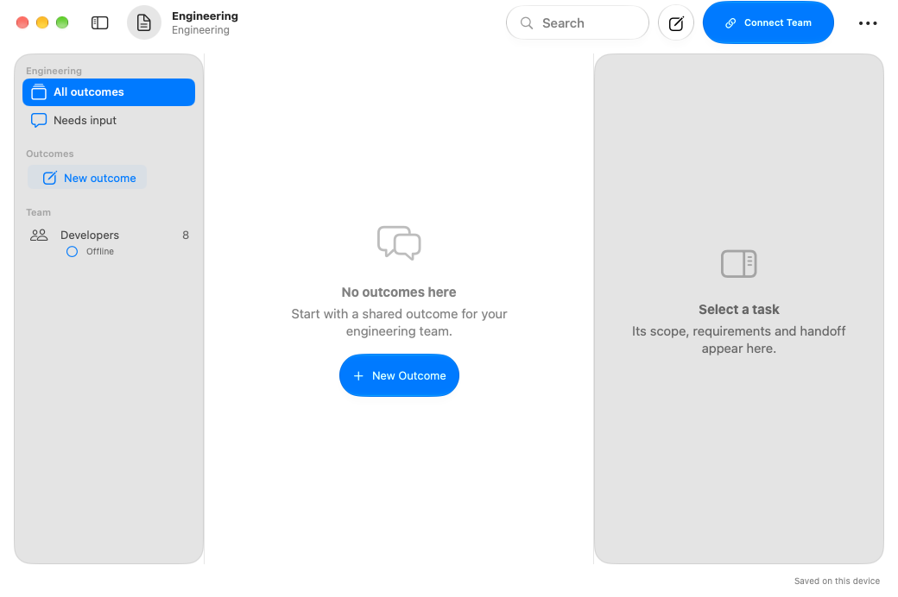

# Actual SDK 27 app launch evidence

These images show production app targets built with Xcode 27 / Swift 6.4. They are not preview-host windows. Each capture retains its source commit separately.

## Current Mac startup — e64b613

The final UI source launched the production Mac app as process `23150`, with visible window `33`. [Exact receipt](e64b613/launch-evidence.json). Both full Apple builds and all 119 core tests passed in [38192293449](https://github.com/kmshdev/foundation-models-utilities/actions/runs/38192293449), but its optional iPhone launch diagnostic failed before installation completed: `simctl install` exceeded 120 seconds, and subsequent simulator list/spawn commands also failed to respond. This run does not establish an iPhone launch at the current source commit.

Native state/framework/auth/service/runtime checks and seven fixture captures passed independently in [38192295529](https://github.com/kmshdev/foundation-models-utilities/actions/runs/38192295529). Hosted simulator failure does not invalidate successful builds or imply a crash in an app that was never launched.

The separate required [build validation 38193065476](https://github.com/kmshdev/foundation-models-utilities/actions/runs/38193065476) passed both SDK 27 targets and all 119 core tests at `e64b613`. Simulator diagnostics recorded 268 runnable processes on the 3-CPU/7GB host, including 199 simulator children. This supports scheduling pressure, without proving a specific OOM or IPC fault. Fresh phone verification needs a responsive, preferably pre-warmed iOS 27 simulator on a higher-capacity Mac: check device-list/boot health, then perform one bounded install, launch and capture. No token or repository secret repairs simulator health.

## Earlier successful Mac and iPhone startup — 2b280cb

[Complete successful run 38189015980](https://github.com/kmshdev/foundation-models-utilities/actions/runs/38189015980) passed **118 core tests**, both full Apple builds, both app launches and screenshot capture. The exact commit, bundle, surviving processes, window and simulator identity are retained in [launch-evidence.json](launch-evidence.json). The separate [normal build run](https://github.com/kmshdev/foundation-models-utilities/actions/runs/38188981683) also passed.

The iPhone first screen includes the New Outcome and More controls in its floating native toolbar. Eight configured specialties remain correctly labeled Offline until an actual runtime connects. These startup captures use an empty local workspace and establish app launch and rendered controls. They do not establish personal account consent, actual developer turns, physical-device signing or assistive-technology interaction.

The bounded diagnostic discovers the selected Xcode's Simulator or Device Hub, closes the Mac app before starting the simulator to release memory, directly launches the installed iOS app, checks its surviving process and saves command receipts on failure. The GUI-open deadline accounts for the measured startup time; no platform or SDK target was lowered.

The later Git-environment fix passed [native builds and all 118 core tests](https://github.com/kmshdev/foundation-models-utilities/actions/runs/38189784070), plus [native regressions](https://github.com/kmshdev/foundation-models-utilities/actions/runs/38189784128), at `b79f343`. Subsequent UI changes are covered by current source evidence above; this earlier phone image remains labeled with its actual commit.
