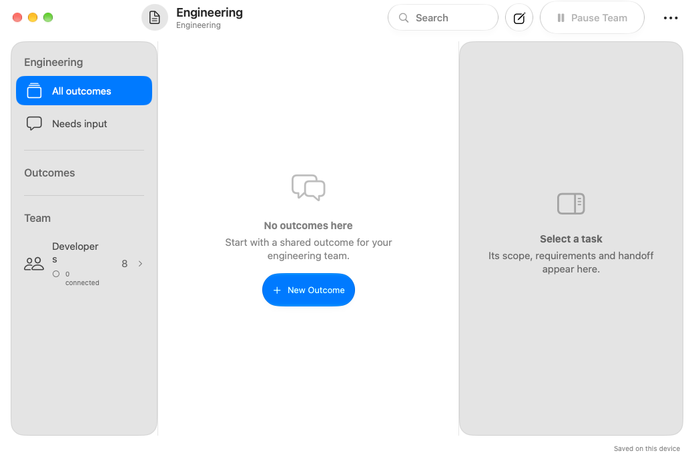

# Actual SDK 27 app launch evidence

Captured from `EngineeringStudioMac.app`, built from commit `946807d` with Xcode 27 / Swift 6.4 and the actual FoundationPlanner and utilities package. It starts with an empty local workspace and disabled external integrations. This is not the SDK 26 preview host.

[Build and diagnostic run](https://github.com/kmshdev/foundation-models-utilities/actions/runs/38156253925): both full native builds and 14 core tests passed. The diagnostic reached the iOS 27 simulator boot stage, then stalled during install/launch and was canceled; no iOS launch screenshot was produced. Overall run status is canceled, not a complete green runtime check. The first successful complete build-only run is [38155972610](https://github.com/kmshdev/foundation-models-utilities/actions/runs/38155972610).
