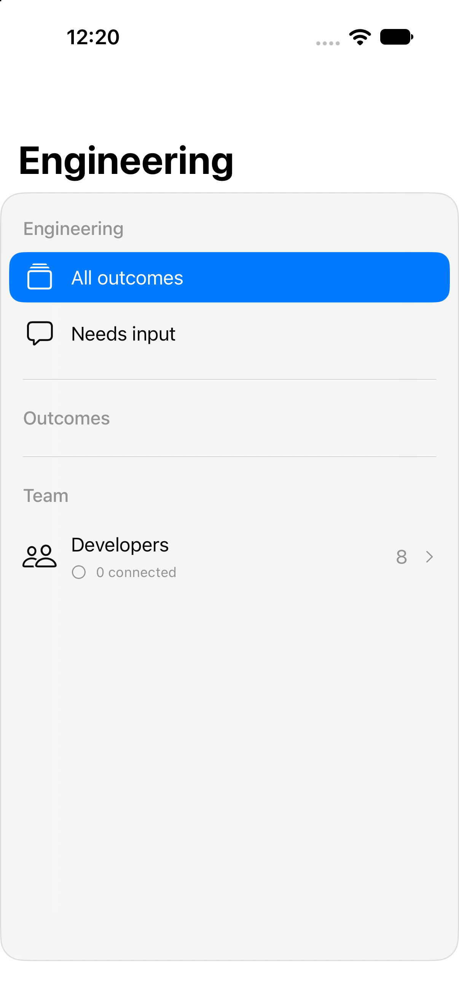

# Actual SDK 27 app launch evidence

These images show the production app targets, built from `2b280cbbbad40b73219fe5dc4729f3798eefc5a3` with Xcode 27 / Swift 6.4. They are not preview-host windows.

[Complete successful run 38189015980](https://github.com/kmshdev/foundation-models-utilities/actions/runs/38189015980) passed **118 core tests**, both full Apple builds, both app launches and screenshot capture. The exact commit, bundle, surviving processes, window and simulator identity are retained in [launch-evidence.json](launch-evidence.json). The separate [normal build run](https://github.com/kmshdev/foundation-models-utilities/actions/runs/38188981683) also passed.

The iPhone first screen includes the New Outcome and More controls in its floating native toolbar. Eight configured specialties remain correctly labeled Offline until an actual runtime connects. These startup captures use an empty local workspace and establish app launch and rendered controls. They do not establish personal account consent, actual developer turns, physical-device signing or assistive-technology interaction.

The bounded diagnostic discovers the selected Xcode's Simulator or Device Hub, closes the Mac app before starting the simulator to release memory, directly launches the installed iOS app, checks its surviving process and saves command receipts on failure. The GUI-open deadline accounts for the measured startup time; no platform or SDK target was lowered.

The later Git-environment fix only changes app-owned developer Git commands. It does not alter the captured startup UI. [Native builds and all 118 core tests](https://github.com/kmshdev/foundation-models-utilities/actions/runs/38189784070), plus [native regressions](https://github.com/kmshdev/foundation-models-utilities/actions/runs/38189784128), passed again at final application source commit `b79f343`.
