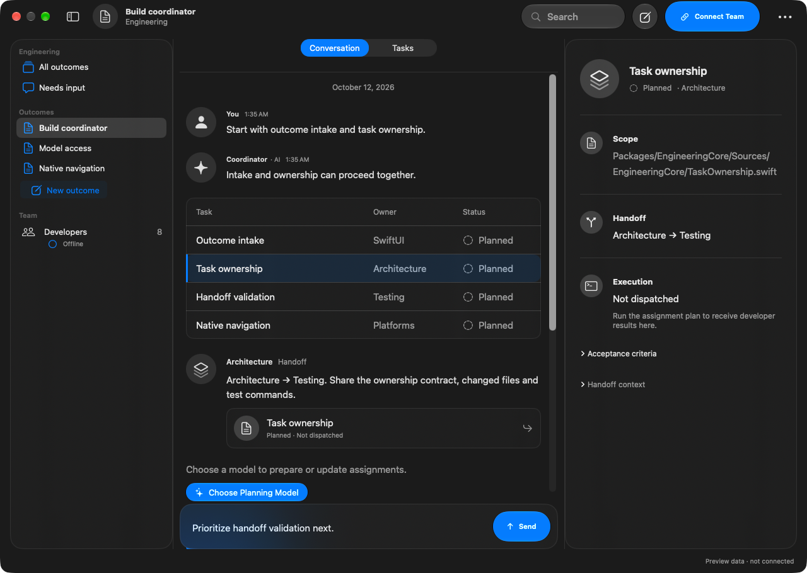
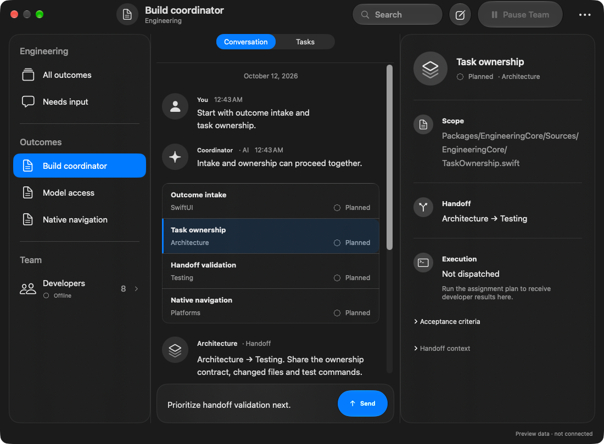
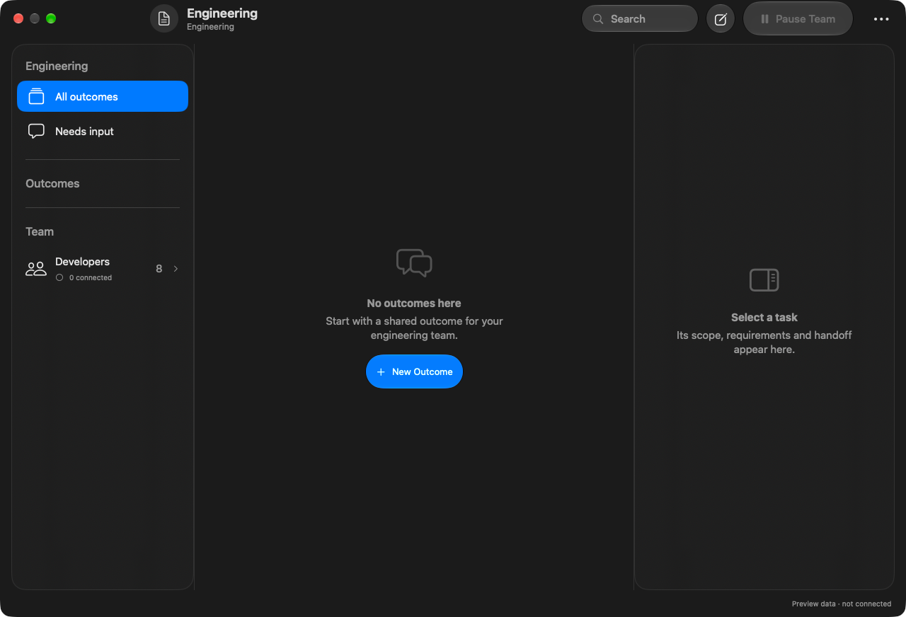
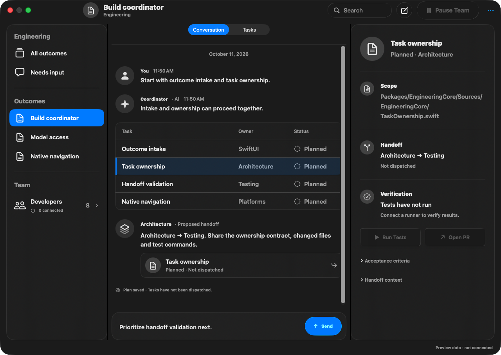
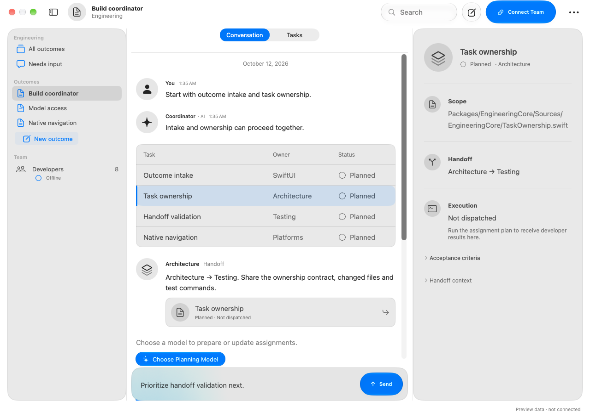

# Native SwiftUI screen captures

Captured from the actual SwiftUI views at `bd1afd8`, with isolated preview data and services disabled. These are foreground native windows, not generated mockups. Reduce Transparency was off. Normal captures use regular legibility; the accessibility capture uses an increased-contrast NSAppearance and bold legibility. Production inherits the user's display settings.

[Native capture, scene/view typechecks and store regression checks](https://github.com/kmshdev/foundation-models-utilities/actions/runs/38137011423). The isolated host uses installed SDK 26 and a disabled model service. It does not establish a successful production Swift 6.4 / SDK 27 build. [Core tests and required-toolchain check](https://github.com/kmshdev/foundation-models-utilities/actions/runs/38137011408). See [design QA](../../design-qa.md) and the [SwiftUI review](../Design/SwiftUI-review.md) for exact scope and blockers.

## Selected outcome and task — 1280 × 910 pixels

## Narrower Mac window — 1100 × 810 pixels

## Empty workspace — 1280 × 872 pixels

## Increased contrast — 1280 × 910 pixels

## Light appearance — 1280 × 910 pixels

